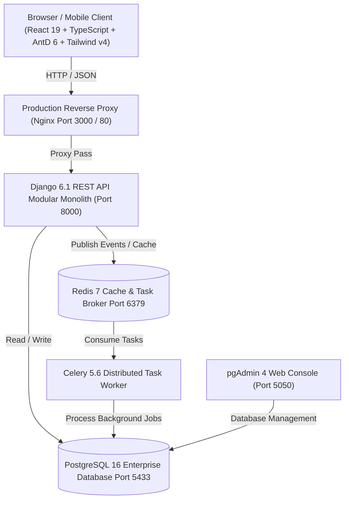

# 🎓 SchoolPro - Enterprise High School Management & Learning Information Platform

[](schoolpro-frontend/)
[](schoolpro-backend/)
[](schoolpro-db/)
[](docker-compose.yml)
[](https://moet.gov.vn)
[](.github/workflows/ci.yml)
[](scripts/quality-code.sh)

**SchoolPro** is a modern, enterprise-grade **School Management Platform (SMS / SIS / ERP / LMS)** purpose-built for secondary and high schools (K-12 Grades 10–12). Engineered as a resilient **Clean Architecture Modular Monolith**, the platform pairs a cutting-edge **React 19 SPA** frontend with a robust **Django 6.1 REST Framework** backend, asynchronous **Celery/Redis** workers, and a **PostgreSQL 16** relational data engine.

SchoolPro is fully compliant with the **Vietnam Ministry of Education and Training (MoET) 2018 General Education Program** and **Circular 22/2021/TT-BGDĐT** assessment standards.

---

## 📑 Table of Contents

1. [Platform Architecture](#-platform-architecture)
2. [Monorepo Directory Layout](#-monorepo-directory-layout)
3. [Core Functional Modules](#-core-functional-modules)
4. [Subproject Ecosystem](#-subproject-ecosystem)
5. [Quick Start with VS Code Tasks (One-Click)](#-quick-start-with-vs-code-tasks-one-click)
6. [Full-Stack Launch with Docker Compose](#-full-stack-launch-with-docker-compose)
7. [Service Endpoints & Credentials](#-service-endpoints--credentials)
8. [Code Quality, Linting & Automated CI/CD](#-code-quality-linting--automated-cicd)
9. [Enterprise Security & Regulatory Compliance](#-enterprise-security--regulatory-compliance)
10. [License](#-license)

---

## 🏛 Platform Architecture



---

## 📁 Monorepo Directory Layout

```text
schoolpro/
├── .github/                         # GitHub Actions automated workflows
│   └── workflows/ci.yml             # 4-stage parallel CI pipeline (Frontend, Backend, DB, Docker)
├── .vscode/                         # Visual Studio Code developer orchestration
│   └── tasks.json                   # One-click execution tasks (DB, Backend, Frontend, Quality)
├── docker-compose.yml               # Production container orchestration
├── scripts/                         # Enterprise operational shell scripts
│   ├── quality-code.sh              # Unified quality gate (Ruff, Oxlint, TSC, Django Check)
│   ├── check-all.sh                 # Fast system diagnostics
│   ├── start-db.sh                  # Database bootstrapper with health checking
│   ├── reset-db.sh                  # Database purge & topological seed re-initialization
│   └── reset-db-no-seed.sh          # Database purge & DDL schema re-creation without seed data
│
├── schoolpro-frontend/              # [Frontend] React 19, TypeScript, Vite 8, Tailwind v4, AntD 6
│   ├── src/modules/students/        # Student portal: Timetable, TT22 gradebook, exams, contact book
│   ├── src/i18n/                    # 5-language internationalization (vi, en, ja, ko, zh)
│   ├── nginx.conf                   # High-performance SPA reverse proxy configuration
│   └── Dockerfile                   # Multi-stage production container build
│
├── schoolpro-backend/               # [Backend] Django 6.1, DRF, Celery, Clean Architecture
│   ├── apps/                        # 7 Bounded Contexts (core, master, academic, emulation, evaluation, notification, system)
│   ├── common/                      # Shared Kernel: BaseModel, BaseRepository, BaseService, JSend responses
│   ├── config/                      # Multi-environment settings (dev, staging, prod, test) & API routes
│   └── requirements/                # Pinned dependency matrices
│
├── schoolpro-db/                    # [Database] PostgreSQL 16 Schemas, DDLs, Views, Seed Scripts
│   ├── sql/00_schemas.sql           # 6 business schemas & PostgreSQL extensions
│   ├── sql/02_tables/               # 85 normalized tables strictly partitioned across domains
│   ├── sql/03_views/                # Real-time analytical views (360 profile, leadership)
│   ├── sql/05_seeds/init.sql        # MoET 2018 curriculum & Circular 22 master seed data
│   └── docker/                      # pgAdmin 4 automated server mounting and credentials
│
└── schoolpro-ai/                    # [AI / Data Science] Predictive analytics & machine learning
    ├── src/                         # ML pipelines, student performance predictors
    └── configs/                     # Model hyperparameter and inference configs
```

---

## 🌟 Core Functional Modules

### 1. Identity, Governance & Granular RBAC (`core`)
- Multi-role support: Principal, School Administrators, Homeroom Teachers, Subject Teachers, Students, Parents/Guardians, Supervisors, and Office Staff.
- Temporal position assignments tracking class leadership and academic committees across school years.
- Dynamic EAV Custom Fields engine allowing schools to add custom data fields without database migrations.

### 2. Academic Operations & MoET 2018 Curriculum (`academic`)
- 10-period bell schedule management (Morning and Afternoon shifts) with automated substitution tracking.
- Electronic Class Journal (*Sổ đầu bài điện tử*) logging lesson topics, student attendance, and period grades.
- Curriculum track management conforming to the MoET 2018 elective tracks (Natural Sciences, Social Sciences, Arts).

### 3. Circular 22 Gradebook & Examination Engine (`academic`)
- Full compliance with **Circular 22/2021/TT-BGDĐT**: Oral assessments, 15-minute quizzes, midterm tests, and final semester exams with automated weighted GPA computation.
- Comprehensive testing suite: Question bank categorized by cognitive levels, online exam proctoring, timer management, and automated score calculations.
- Official digital transcripts (*Học bạ điện tử*) and formal term-end summary scorecards.

### 4. Emulation, Discipline & Conduct (`emulation`)
- Multi-tier emulation engine combining school-wide criteria with class-specific rules.
- Red Star inspector (*Cờ đỏ*) logs, supervisor duty journals, and automated weekly/monthly class leaderboards.
- Formal disciplinary records and extracurricular merit awards.

### 5. Quality Assurance & Facility Incident Management (`evaluation`)
- 100% anonymous end-of-semester pedagogical surveys for students to rate teaching quality.
- Classroom physical asset inventories and maintenance ticket dispatch tracking.

### 6. Multichannel Communication & Digital Contact Book (`notification`)
- Broadcast announcements with targeted audience filters (school-wide, grade-specific, class-specific) and read receipts.
- Digital Contact Book (*Sổ liên lạc điện tử*) delivering periodical grade, attendance, and conduct digests to parents.
- Direct 1-on-1 parent-teacher private messaging and push notifications (FCM & APNs).

### 7. Intelligent System Infrastructure (`sys`)
- Dynamic role-based dashboard cards with personal drag-and-drop customization.
- 4-tier cascading system settings resolution:
  $$\text{User Preference} \longrightarrow \text{Role Default} \longrightarrow \text{School Setting} \longrightarrow \text{System Default}$$
- Immutable audit trail recording before/after JSONB snapshots.
- Transactional Event Outbox pattern guaranteeing reliable event publishing to Celery.

---

## 📦 Subproject Ecosystem

For comprehensive documentation, review the dedicated README files:

| Subproject | Directory | Tech Stack | Documentation |
| :--- | :--- | :--- | :--- |
| **Frontend Portal** | [`schoolpro-frontend/`](schoolpro-frontend/) | React 19, TypeScript, Vite, Tailwind v4, Ant Design 6, Zustand, i18next | [Frontend README](schoolpro-frontend/README.md) |
| **Backend API** | [`schoolpro-backend/`](schoolpro-backend/) | Django 6.1, DRF, Celery, Redis, Clean Architecture, SimpleJWT, Ruff | [Backend README](schoolpro-backend/README.md) |
| **Database Architecture** | [`schoolpro-db/`](schoolpro-db/) | PostgreSQL 16, 6 Schemas, 85 Tables, pgAdmin 4, Docker Compose | [Database README](schoolpro-db/README.md) |

---

## ⚡ Quick Start with VS Code Tasks (One-Click)

The project includes pre-configured VS Code tasks in `.vscode/tasks.json` for one-click development workflows:

Press `Ctrl + Shift + P` (or `Cmd + Shift + P` on macOS) $\rightarrow$ Select **Tasks: Run Task**:

| Task Name | Operational Function | Underlying Command |
| :--- | :--- | :--- |
| **`start db`** | Starts PostgreSQL 16 (port 5433) & pgAdmin 4 (port 5050) | `bash scripts/start-db.sh` |
| **`start backend`** | Activates `.venv` and boots Django development server | `python manage.py runserver 0.0.0.0:8000` |
| **`start frontend`** | Starts Vite development server at `http://localhost:5173` | `npm run dev` |
| **`seed python`** | Runs Django migrations and seeds master data | `python manage.py migrate && python manage.py db_seed` |
| **`quality code`** | Executes full quality gates (Ruff, Oxlint, TypeScript tsc, Django check) | `bash scripts/quality-code.sh` |
| **`quality code: fix`** | Automatically formats and fixes all linting issues across the repo | `bash scripts/quality-code.sh --fix` |
| **`reset db`** | Purges database volumes and re-initializes all tables and seeds | `bash scripts/reset-db.sh` |
| **`stop all services`** | Stops database containers and terminates backend and frontend processes | Container down & port cleanup |

---

## 🐳 Full-Stack Launch with Docker Compose

To boot the entire ecosystem in isolated, production-grade Docker containers:

```bash
# 1. Clone the repository and navigate to root
cd schoolpro

# 2. Copy the environment variables
cp .env.example .env

# 3. Build and launch all container services
docker compose up -d --build

# 4. Verify running services
docker compose ps
```

---

## 🌐 Service Endpoints & Credentials

When the full stack is running, access the services using these default endpoints:

| Service | Endpoint | Default Credentials | Description |
| :--- | :--- | :--- | :--- |
| **Frontend Portal** | [http://localhost:3000](http://localhost:3000) | User account | React 19 Production SPA (Port `5173` in local dev mode) |
| **Backend REST API** | [http://localhost:8000](http://localhost:8000) | Token / Session | Django REST Framework API Root |
| **Swagger UI Docs** | [http://localhost:8000/api/docs/](http://localhost:8000/api/docs/) | *Public* | Interactive OpenAPI 3.0 testing documentation |
| **ReDoc Documentation**| [http://localhost:8000/api/redoc/](http://localhost:8000/api/redoc/) | *Public* | Three-panel reference documentation |
| **Health Check** | [http://localhost:8000/api/health/](http://localhost:8000/api/health/) | *Public* | Probes database connectivity and cache response |
| **Django Admin** | [http://localhost:8000/admin/](http://localhost:8000/admin/) | `admin` / `password123` | Django administrative back-office |
| **pgAdmin 4** | [http://localhost:5050](http://localhost:5050) | `admin@schoolpro.edu.vn` / `admin` | Auto-mounted database GUI console |
| **PostgreSQL DB** | `localhost:5433` | `postgres` / `password123` | Database direct connection (DB name: `schoolpro`) |

---

## 🔍 Code Quality, Linting & Automated CI/CD

SchoolPro adheres to zero-compromise enterprise code quality standards.

### 1. Unified Quality Gate Script
Run the automated quality script across both frontend and backend in a single command:

```bash
# Run full verification (Frontend: Oxlint + TSC; Backend: Ruff + Django Check)
bash scripts/quality-code.sh

# Automatically fix all formatting and linting discrepancies
bash scripts/quality-code.sh --fix
```

### 2. Automated 4-Stage GitHub Actions CI Pipeline
Every Pull Request and commit to the `main` branch undergoes automated validation in parallel:
- **`frontend-ci`**: Oxlint static analysis, TypeScript strict compilation check, and Vitest test suites.
- **`backend-ci`**: Ruff linting, Ruff formatting check, Django model check, and Pytest execution with in-memory database.
- **`database-ci`**: Topological SQL schema initialization test ensuring zero foreign-key constraint failures.
- **`docker-ci`**: Container image build test verifying that production Dockerfiles build successfully.

---

## 🔒 Enterprise Security & Regulatory Compliance

- **Role-Based Access Control (RBAC)**: Enforces least-privilege permissions across all API endpoints with strict domain policy filters.
- **Data Protection & Anonymization**: Student evaluation surveys of teachers are protected by cryptographic one-way hashing, guaranteeing zero retaliatory bias.
- **Audit Trails**: Critical state mutations (e.g., score entry, disciplinary action, fee reconciliation) are permanently logged with Before/After JSONB snapshots and origin IP addresses.
- **MoET 2018 & Circular 22 Compliance**: Eliminates manual GPA calculation errors by automating weighted grade calculations according to official national standards.

---

## 📄 License

SchoolPro is proprietary software owned by the SchoolPro Engineering and Architecture Team. All rights reserved.
